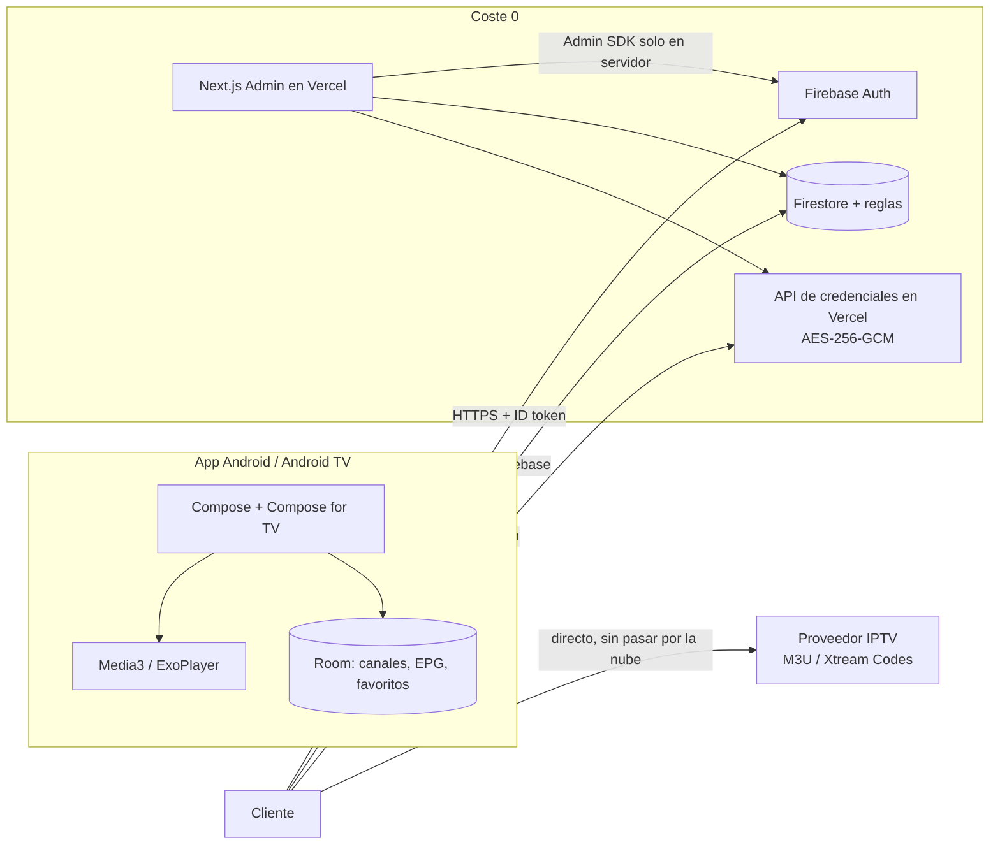

# IptvUp — Plan técnico

**App IPTV para Android y Android TV, con perfiles sincronizados en la nube, login y panel de administración web. Coste objetivo: 0 €.**

Fecha: 2026-11-02 · Estado: base implementada, pendiente de conectar tus credenciales de Firebase y probar con una lista real.
Revisión 2: backend Firebase (sin pausas) + actualizaciones in-app sin Play Store.

### Estado de implementación

- [x] Monorepo (`android/`, `web/`, `firebase/`, `updates/`).
- [x] App Android + Android TV: login, perfiles M3U/Xtream, canales, búsqueda, favoritos, grupos ocultos, reproductor Media3, EPG XMLTV, ajustes.
- [x] Deduplicación eliminada: se conservan todos los canales y variantes de calidad.
- [x] Sincronización filtrada por grupos visibles, con opción manual de actualizar todo.
- [x] EPG de respaldo para España desde epgshare01.online.
- [x] Tarjeta de eventos deportivos con acceso al canal de mejor calidad.
- [x] Arranque automático en el último perfil usado.
- [x] Buscador por icono en TV/Guía y eliminación del icono de pantalla completa en TV.
- [x] Edición de perfiles, iconos de perfil personalizables, Picture-in-Picture y Chromecast (móvil).
- [x] Android TV y móvil: navegación por tarjetas de grupos con icono y búsqueda, y lista de canales con botón de volver.
- [x] Sincronización diaria (24 h) con caché inmediata y actualización manual forzada.
- [x] EPG limitada a los grupos visibles; los grupos ocultos se omiten al guardar programas.
- [x] Ajustes globales desde la selección de perfiles: actualizaciones y acerca de.
- [x] Panel web: login admin, dashboard, usuarios, creación, activación/desactivación, borrado, reset de contraseña, roles.
- [x] API de perfiles con cifrado AES-256-GCM.
- [x] Reglas de Firestore.
- [x] Actualizador in-app con SHA-256 y verificación de firma.
- [x] Workflow de GitHub Actions para APK y releases.
- [ ] Crear el proyecto Firebase real y rellenar `google-services.json` / `.env.local`.
- [ ] Desplegar el panel en Vercel y apuntar `API_BASE_URL` al dominio.
- [ ] Probar con una lista real y un Android TV físico.
- [x] Sincronización en segundo plano: entrada inmediata con caché y actualización asíncrona al abrir el perfil.
- [x] Reproductor: guía EPG ampliable, gestos de canal/volumen/brillo y cambio de canal con D-pad en TV.
- [x] EPG de respaldo para canales españoles sin `tvg-id` desde epgshare01.online.

---

## 1. Decisión recomendada (resumen)

| Capa | Tecnología | Por qué |
|---|---|---|
| App móvil + TV | **Kotlin + Jetpack Compose + Compose for TV** | Una sola APK, máximo rendimiento y el mejor reproductor (Media3/ExoPlayer) |
| Reproductor | **AndroidX Media3 (ExoPlayer)** | HLS, DASH, MPEG-TS, audio/subs, reintentos, buffering fino |
| Backend | **Firebase Spark** (Auth + Firestore + reglas) | Sin pausas por inactividad, SDK oficial de Android, 0 € |
| Panel admin | **Next.js + TypeScript + Tailwind + shadcn/ui** en **Vercel Hobby** | Despliegue gratis, Firebase Admin SDK solo en servidor |
| Sincronización | Metadatos en Firestore; playlist y EPG en caché local (Room) | No tiene sentido subir 50 MB de canales a la nube |
| Distribución | APK firmada + **actualizador in-app desde GitHub Releases** | Sin Play Store y con actualizaciones cómodas para ti y tu amigo |
| Repositorio | Monorepo: `android/`, `web/`, `firebase/` | Un solo sitio para todo |

**Una sola app Android** para móvil y TV, con dos “shells” de UI que comparten datos, dominio y reproductor. No dos apps separadas.

---

## 2. Por qué nativo y no Flutter / React Native

| Criterio | Kotlin nativo | Flutter | React Native TV |
|---|---|---|---|
| Calidad de reproducción IPTV | ★★★★★ (Media3) | ★★★☆ (plugins) | ★★★☆ (react-native-video) |
| D-pad / foco en Android TV | ★★★★★ | ★★★ (manual) | ★★★★ |
| Rendimiento en TV boxes baratos | ★★★★★ | ★★★★ | ★★★ |
| Playlist de 100k canales + EPG | ★★★★★ | ★★★★ | ★★★ |
| Un solo código para móvil + TV | ★★★★★ | ★★★★ | ★★★★ |
| Ecosistema oficial Android TV | ★★★★★ | ★★★ | ★★★ |

Para exactamente dos targets (Android y Android TV), lo nativo es la opción con menos fricción y mejor resultado. Flutter sería defendible si en el futuro quisieras iOS/web; hoy añade riesgo en el punto más crítico: el player y el mando a distancia.

---

## 3. Arquitectura



### Flujo principal

1. El usuario abre la app → login con email/contraseña (Firebase Auth).
2. Se descargan sus **perfiles IPTV** de Firestore (las reglas solo le dejan ver los suyos).
3. Elige perfil → la app pide las credenciales descifradas a una API route de Vercel.
4. La app descarga la lista M3U o llama a la API Xtream **directamente al proveedor** y guarda canales/grupos en Room.
5. El EPG se descarga y se guarda también en local.
6. Favoritos y elementos ocultos se sincronizan en subcolecciones de Firestore.
7. El admin crea/desactiva usuarios desde el panel web.

**Importante:** la nube solo guarda configuración y metadatos. Playlist y EPG viven en el dispositivo: menos coste, arranque más rápido y funcionamiento offline.

---

## 4. Backend: Firebase Spark (sin pausas)

### 4.1 Por qué Firebase y no Supabase

| | Firebase Spark | Supabase Free |
|---|---|---|
| ¿Se pausa por inactividad? | **No** | Sí, tras 7 días |
| Base de datos | Firestore (NoSQL) | Postgres (SQL) |
| Seguridad | Reglas de Firestore + custom claims | RLS |
| Auth | Email/contraseña, SDK oficial Android | Email/contraseña, SDK comunitario |
| Tiempo real | Listeners nativos | Realtime |
| Admin desde Vercel | Firebase Admin SDK | service role |
| Límite free | 1 GiB, 50k lecturas/día, 20k escrituras/día | 500 MB + pausa |
| Lock-in | Alto | Bajo |

Firebase Spark **no requiere tarjeta ni Cloud Functions**. El Admin SDK se usa desde las API routes de Vercel, que son gratis. Para 3 usuarios, los límites son enormes y, sobre todo, **no hay pausa por inactividad**.

**Alternativas sin pausa** (por si no quieres Firebase):

- **Neon + Better Auth**: Postgres serverless que no se pausa (se suspende y despierta en ~0,5 s), pero hay que montar auth y API propios. Más trabajo y más código que mantener.
- **Cloudflare Workers + D1**: free muy generoso y sin pausa, pero auth y backend a medida. Para avanzar rápido, no.
- **Supabase + ping diario**: funciona, pero es justo lo que quieres evitar.
- **PocketBase en un VPS free (Oracle Always Free)**: 0 € y sin pausa, pero requiere mantener servidor, TLS y backups. No lo recomiendo para este caso.

### 4.2 Modelo de datos en Firestore

```
users/{uid}
  email, displayName, role ("admin" | "user"), status, createdAt, lastSeenAt

users/{uid}/iptvProfiles/{profileId}
  name, kind ("m3u" | "xtream"), m3uUrlEnc, xtreamHost,
  xtreamUsername, xtreamPasswordEnc, epgUrl, settings, sortOrder,
  createdAt, updatedAt

users/{uid}/iptvProfiles/{profileId}/favorites/{channelKey}
  createdAt

users/{uid}/iptvProfiles/{profileId}/hidden/{itemKey}
  kind ("group" | "channel"), createdAt
```

- `channelKey` estable: `xtream:{profileId}:{streamId}` o `tvg-id` / hash de URL para M3U.
- Los IDs de Firestore son strings; no hace falta UUID, aunque se puede usar.
- **No se guardan canales ni EPG en Firestore**: solo configuración y metadatos.

### 4.3 Reglas de seguridad

```js
rules_version = '2';
service cloud.firestore {
  match /databases/{database}/documents {
    function isOwner(uid) {
      return request.auth != null && request.auth.uid == uid;
    }
    function isAdmin() {
      return request.auth != null && request.auth.token.admin == true;
    }

    match /users/{uid} {
      allow read, write: if isOwner(uid) || isAdmin();

      match /iptvProfiles/{profileId} {
        allow read, write: if isOwner(uid) || isAdmin();

        match /favorites/{channelKey} {
          allow read, write: if isOwner(uid) || isAdmin();
        }
        match /hidden/{itemKey} {
          allow read, write: if isOwner(uid) || isAdmin();
        }
      }
    }
  }
}
```

- El rol admin se pone como **custom claim** (`admin: true`) con el Admin SDK; el campo `role` de Firestore es solo informativo.
- Registro público desactivado en Firebase Auth: los usuarios los crea el admin.
- Las reglas se despliegan con Firebase CLI (`firebase deploy --only firestore:rules`).
- El primer admin se crea en la consola de Firebase y se le pone el claim con un script puntual (o desde el panel una vez exista).

### 4.4 Cifrado de credenciales

Las URLs M3U y las credenciales Xtream son secretos.

- Se cifran con **AES-256-GCM** en una API route de Vercel (`/api/credentials`), con la clave en una variable de entorno (`CREDENTIALS_KEY`).
- La app envía su **Firebase ID token**; el servidor lo verifica con el Admin SDK, comprueba que el perfil pertenece al usuario y devuelve las credenciales descifradas por HTTPS.
- La app las cachea localmente cifradas con **Android Keystore**.
- El panel admin solo ve metadatos; nunca descifra ni muestra credenciales.
- Alternativa E2E (fase 3): cifrar en el dispositivo con una clave derivada de un PIN de bóveda; el servidor nunca podría descifrar. Más privado, pero si se pierde el PIN se pierden los datos.

### 4.5 Límites y operación

- Firestore: 1 GiB, 50k lecturas/día, 20k escrituras/día. Solo metadatos: sobra para 3 usuarios.
- Auth: email/contraseña gratis; 3 usuarios.
- **No hay pausa por inactividad.**
- Backups: exportación periódica de Firestore a JSON desde el panel (opcional) o un script con el Admin SDK.
- Emails de reset: Firebase Auth los envía; para 3 usuarios es suficiente.

---

## 5. Panel de administración web

**Stack:** Next.js (App Router) + TypeScript + Tailwind + shadcn/ui + Firebase REST (Identity Toolkit) + `firebase-admin`.
**Deploy:** Vercel Hobby (gratis, uso personal).

### Pantallas

1. **Login** (solo admins; sin registro).
2. **Dashboard:** usuarios totales, activos, últimos accesos, perfiles por usuario.
3. **Usuarios:** tabla con email, estado, nº de perfiles, último acceso.
4. **Crear usuario:** email + contraseña temporal (o invitación). Crea el usuario en Firebase Auth + documento en `users/{uid}`.
5. **Detalle de usuario:** perfiles IPTV (nombre y tipo, sin secretos), dispositivos/última actividad.
6. **Acciones:** desactivar/activar, resetear contraseña, eliminar cuenta.
7. **Ajustes:** versión mínima de la app, aviso global, enlace de descarga del APK.
8. **Auditoría** (opcional): quién creó/desactivó a quién.

### Seguridad del panel

- Middleware que exige sesión + custom claim `admin`.
- Server actions con validación Zod.
- `FIREBASE_SERVICE_ACCOUNT` solo en el servidor (`server-only`).
- MFA TOTP para el admin (fase 2, Firebase Auth lo soporta).
- Reset de contraseña: Firebase Auth envía el email; el admin también puede generar un enlace desde el panel.

---

## 6. App Android / Android TV

### 6.1 Estructura

```
android/
  app/
    src/main/java/.../
      core/          # red, base de datos, datastore, diseño
      data/          # repositorios (auth, perfiles, playlist, EPG)
      domain/        # modelos y casos de uso
      ui/mobile/     # navegación y pantallas táctiles
      ui/tv/         # navegación y pantallas para TV
      player/        # Media3, controles, pista de audio/subtítulos
    src/main/res/
      values/        # móvil
      values-television/  # tamaños y espaciados para TV
```

- **Una actividad principal** + Navigation Compose; se detecta TV con `uiMode` y se carga el grafo de TV o el de móvil.
- `minSdk 24`, `targetSdk` actual, `compileSdk` actual.
- Hilt para inyección de dependencias, Room para caché, DataStore para ajustes, Coil para logos y `SyncManager` para refrescos en segundo plano al entrar al perfil.
- **Firebase Auth + Firestore SDK** para login y sincronización; OkHttp para descargar M3U/EPG y para la API de credenciales (con User-Agent configurable).

### 6.2 Pantallas móvil

1. Splash / comprobación de sesión.
2. Login (email + contraseña, recordar sesión).
3. Selector de perfiles IPTV.
4. Crear/editar perfil: M3U o Xtream + botón “probar conexión”.
5. Inicio: continuar viendo, favoritos, accesos rápidos.
6. TV en directo: grupos → canales, búsqueda, filtros.
7. Guía EPG: parrilla por horas, “ahora / después”.
8. Favoritos.
9. Ajustes/cuenta: cerrar sesión, cambiar contraseña, buffer, idioma, tema.
10. Reproductor a pantalla completa.

### 6.3 Pantallas Android TV

Navegación por rail lateral con D-pad:

1. Login (teclado del mando; en fase 3, login por código/QR desde el móvil).
2. Selector de perfiles.
3. Inicio.
4. TV en directo: lista de canales + **panel de previsualización** (logo, ahora/después, mini-player silenciado opcional).
5. Guía EPG.
6. Favoritos.
7. Búsqueda.
8. Ajustes.
9. Reproductor con overlay para mando: info del canal, EPG, favorito, audio, subtítulos, aspecto, lista de canales.

Detalles TV imprescindibles:

- `CATEGORY_LEANBACK_LAUNCHER` + banner 320×180.
- `android.software.leanback` y `android.hardware.touchscreen` como `required="false"` para que la misma APK valga en móvil.
- Zonas seguras de overscan (5 %), foco visible, textos grandes, 16:9.
- Memoria de foco al volver de una pantalla.
- Botones Back/OK/arriba/abajo/izquierda/derecha bien resueltos; teclas numéricas para zap si el mando las tiene.
- No depender de hover ni de gestos táctiles.

### 6.4 Reproductor

- **Media3 ExoPlayer** con HLS, DASH y TS progresivo.
- `OkHttpDataSource` con User-Agent configurable (muchos proveedores bloquean UAs desconocidos).
- Buffer configurable (5–15 s), reintentos, timeouts, audio focus, `KEEP_SCREEN_ON`.
- Selección de pista de audio y subtítulos; cambio de relación de aspecto.
- Live sin duración: badge “EN DIRECTO”, sin barra de progreso.
- En móvil: PiP (fase 3), gestos de volumen/brillo.
- En TV: mini-player de previsualización opcional (segundo ExoPlayer silenciado); desactivable en TV boxes lentas.

### 6.5 Playlist y EPG

**M3U**
- Parser en streaming (no cargar 50 MB en memoria).
- Soporta `#EXTINF` con `tvg-id`, `tvg-name`, `tvg-logo`, `group-title`, `#EXTGRP`, `#EXTVLCOPT` (User-Agent).
- Inserción en Room por lotes dentro de transacciones; barra de progreso.
- Sin deduplicación: se conservan todos los canales; clave única por URL/streamId.

**Xtream Codes**
- `player_api.php` para categorías y canales.
- `xmltv.php` para EPG.
- URLs de reproducción `host/live/user/pass/{id}.m3u8` (o `.ts`).
- Caché local de categorías/canales.

**EPG (XMLTV)**
- Descarga directa (soporta `.gz` aunque el servidor no mande la cabecera).
- Parseo streaming con `XmlPullParser`.
- Room: `programs(channel_id, start, end, title, description)`.
- Refresco al abrir la app, al entrar al perfil y periódicamente mientras la pantalla está activa.
- Parrilla Compose: eje temporal + lista de canales con scroll sincronizado; línea de “ahora”; detalle al pulsar.

**Clave de canal** (para favoritos/ocultos estables):
- Xtream: `xtream:{profile_id}:{stream_id}`.
- M3U: `tvg-id` si existe; si no, hash de la URL; fallback nombre + grupo.

### 6.6 Sincronización y offline

- La app funciona con la última playlist/EPG cacheada aunque no haya red.
- Al hacer login en otro dispositivo se descargan los perfiles y se reconstruye la caché local.
- Favoritos y ocultos: subcolecciones en Firestore (idempotentes) + caché local; listeners en tiempo real o refresco al volver a primer plano.
- Cambios de metadatos del perfil: last-write-wins con `updatedAt`.
- No se sincroniza la playlist completa ni el EPG.

### 6.7 Seguridad en la app

- Tokens de sesión en almacenamiento cifrado (Keystore).
- Credenciales cacheadas cifradas; nunca en logs.
- HTTPS obligatorio; sin certificados laxos.
- Sin telemetría de contenido; logs solo de errores técnicos.

### 6.8 Actualizaciones sin Play Store

**Recomendado: actualizador propio + GitHub Releases.**

`updates/latest.json` en el repo (o en un repo público solo para releases):

```json
{
  "versionCode": 12,
  "versionName": "1.2.0",
  "apkUrl": "https://github.com/usuario/IptvUp/releases/download/v1.2.0/IptvUp-1.2.0.apk",
  "sha256": "...",
  "minSupportedVersionCode": 8,
  "notes": "Mejoras en la guía EPG y correcciones"
}
```

Flujo:

1. La app comprueba al arrancar (máximo 1 vez/día) y desde Ajustes → “Buscar actualizaciones”.
2. Compara `versionCode`. Si hay una nueva, muestra un diálogo con notas, tamaño y botones **Actualizar / Más tarde / Omitir esta versión**.
3. Si `minSupportedVersionCode` es mayor que la instalada, la actualización es obligatoria (no cancelable).
4. Descarga con `DownloadManager` y muestra progreso.
5. Verifica **SHA-256** y que la **firma del APK coincide** con la de la app instalada.
6. Lanza el instalador del sistema con `FileProvider` (`ACTION_VIEW`, MIME `application/vnd.android.package-archive`).
7. Android 8+ pide permiso para “instalar apps desconocidas” la primera vez; la app lleva al ajuste correspondiente. En Android TV, el instalador funciona con el mando; algunos TV boxes requieren activar “Orígenes desconocidos”.

Detalles importantes:

- Misma `applicationId` y **mismo keystore** siempre: así la actualización se instala encima sin perder datos.
- Si se pierde el keystore, no se podrán instalar actualizaciones encima; habría que desinstalar y perder la caché local.
- La primera instalación se comparte como APK (GitHub Releases, Google Drive, etc.). A partir de ahí, todo se actualiza desde la app.
- Si el repo del código es privado, usa un repo público solo para releases o Cloudflare R2 (free) para que la app descargue el APK sin tokens.
- Automatización: GitHub Actions en cada tag `v*` compila, firma con secrets, calcula SHA-256, crea el Release y actualiza `latest.json`.

**Alternativa gestionada:** Firebase App Distribution (gratis) con su SDK de actualización. Menos código, pero hay que dar de alta al amigo como tester y aceptar la invitación; además el diálogo está menos integrado con el diseño de la app. Para 1–3 personas, el actualizador propio es más cómodo.

**Otra alternativa:** que tu amigo use Obtainium (open source) para seguir los releases de GitHub y actualizar automáticamente. No es in-app, pero requiere cero código.

---

## 7. Costes

| Servicio | Plan | Coste |
|---|---|---|
| Firebase Spark (Auth + Firestore) | Free (1 GiB, sin pausa) | 0 € |
| Vercel | Hobby (100 GB bandwidth) | 0 € (uso personal/no comercial) |
| GitHub | Free (repo + Releases para APKs) | 0 € |
| Android Studio / SDK | Free | 0 € |
| Dominio | Opcional (`*.vercel.app` gratis) | ~10–15 €/año |
| Google Play Console | No necesario | 0 € |
| Firma APK | Keystore propio | 0 € |

**Total obligatorio: 0 €.**

Límites a vigilar: 1 GiB y 50k lecturas/día de Firestore (solo metadatos: sobra) y que Vercel Hobby no permite uso comercial. **No hay pausa por inactividad.**

---

## 8. Roadmap

### Fase 0 — Base (2–3 días)
- Monorepo, Android Studio, proyecto Firebase, Vercel.
- Firestore + reglas + custom claim del primer admin.
- Panel admin mínimo: login + listar/crear/desactivar usuarios.
- Login Android + sesión persistente.
- CI: build debug APK en GitHub Actions.

### Fase 1 — MVP usable (2–3 semanas)
- Perfiles IPTV: crear/editar/borrar, M3U y Xtream, probar conexión.
- Sincronización de perfiles en la nube.
- Lista de canales por grupos, búsqueda, favoritos, ocultar grupos/canales.
- Reproductor Media3 con controles móvil y TV.
- UI TV con D-pad y previsualización básica.
- Panel admin completo (usuarios + perfiles + reset de contraseña).
- APK firmada + `updates/latest.json` + actualizador in-app probado en móvil y TV.

### Fase 2 — EPG y pulido (1–2 semanas)
- Descarga y parseo XMLTV, parrilla EPG, ahora/después.
- Previsualización de canal en TV y móvil.
- Caché offline, refresco automático, ajustes (buffer, UA, tema, idioma).
- Sincronización de favoritos/ocultos entre dispositivos.
- Onboarding, estados vacíos, errores, animaciones, accesibilidad.
- MFA para el admin.
- Release automatizado con GitHub Actions (tag → APK firmada → Release → `latest.json`).

### Fase 3 — Extras (opcional)
- Catch-up/timeshift (si el proveedor lo soporta).
- Grabación local en TV box.
- PiP, Chromecast, login por QR en TV.
- PIN para grupos ocultos/adultos.
- Canales beta/estable para las actualizaciones (opcional).
- Web player (solo si el proveedor permite CORS; no es prioritario).
- Publicación en Play Store (con riesgo de rechazo).

**Estimación realista:** MVP funcional en 2–3 semanas a buen ritmo; app pulida con EPG en 4–6 semanas. Como side project, 2–3 meses.

---

## 9. Qué necesitas

### Cuentas y software
- **Android Studio** (incluye JDK y SDK) + imagen de emulador **Android TV**.
- Cuenta **Google** + proyecto **Firebase** (free, sin tarjeta).
- Cuenta **Vercel** (free) + **GitHub**.
- Node.js 20+ y pnpm para el panel web.
- **Keystore** de firma (guárdalo en un gestor de contraseñas y en GitHub Secrets).
- Opcional: dominio propio. Play Console no hace falta.

### Para probar de verdad
- Un **móvil Android** y, muy recomendable, un **Android TV / Google TV stick** real. El emulador de TV vale para UI, pero para vídeo y rendimiento no.
- Una **lista M3U o credenciales Xtream de prueba legales** (tu proveedor). Para desarrollo se puede empezar con streams públicos de prueba (por ejemplo, HLS de demostración) y una playlist de canales públicos.

### Conocimientos
- No necesitas programar: el plan asume que yo escribo el código y tú pruebas y decides.
- Sí necesitas saber dónde poner las claves (te guío) y probar en dispositivos reales.

---

## 10. Riesgos y mitigaciones

| Riesgo | Impacto | Mitigación |
|---|---|---|
| Google Play rechaza apps IPTV | Alto | No usar Play; APK + actualizador propio |
| Legalidad de las listas | Alto | La app no incluye contenido; el usuario aporta su fuente; aviso legal |
| Proveedor bloquea User-Agent / geobloqueo | Medio | UA configurable, probar conexión, mensajes claros |
| TV boxes lentas con EPG/playlist grandes | Medio | Parseo streaming, Room, límites y progreso; preview desactivable |
| Audio AC3/EAC3 no soportado en algún dispositivo | Medio | Usar decodificadores del dispositivo; fallback a otra pista; valorar extensión FFmpeg |
| Límites free de Firestore | Bajo | Solo metadatos; export JSON periódico |
| Instalación de APK bloqueada por el dispositivo | Medio | Guía de “orígenes desconocidos”; fallback navegador/Downloader |
| Pérdida del keystore | Alto | Backup en gestor de contraseñas + GitHub Secrets; sin él no hay actualizaciones encima |
| Reglas de Firestore mal configuradas | Alto | Tests con emulador; custom claim para admin; cifrado de credenciales |
| Credenciales filtradas | Alto | AES-256-GCM, reglas, nunca en logs ni en el panel, Keystore local |
| Playlist/EPG enormes | Medio | Caché local, refresco incremental, no subir a la nube |
| Login en TV incómodo con mando | Bajo | Teclado del sistema; fase 3: código/QR desde el móvil |

---

## 11. Decisiones abiertas (con mi recomendación)

1. **Backend:** Firebase (recomendado, sin pausa) vs Neon + Better Auth (más trabajo).
2. **Actualizaciones:** APK + actualizador propio (recomendado) vs Firebase App Distribution u Obtainium.
3. **Cifrado:** en servidor (recomendado, simple) vs extremo a extremo con PIN.
4. **Alcance del MVP:** sin EPG (más rápido) vs con EPG desde el principio.
5. **Idioma:** español (recomendado) con textos preparados para i18n.
6. **Diseño:** oscuro por defecto, acentos configurables; mobile-first y TV-safe.

---

## 12. Próximo paso propuesto

1. Confirmar las decisiones de la sección 11.
2. Crear el monorepo y el proyecto Firebase.
3. Implementar Firestore + reglas + panel admin de usuarios.
4. Implementar login + perfiles + importación M3U/Xtream en Android.
5. Probar con una lista real y un dispositivo TV.
6. Añadir reproductor, favoritos y ocultos.
7. Actualizador in-app + primera APK firmada.
8. EPG y pulido.

Con una lista de prueba legal disponible, la Fase 0 y la Fase 1 se pueden tener funcionando en pocos días.
